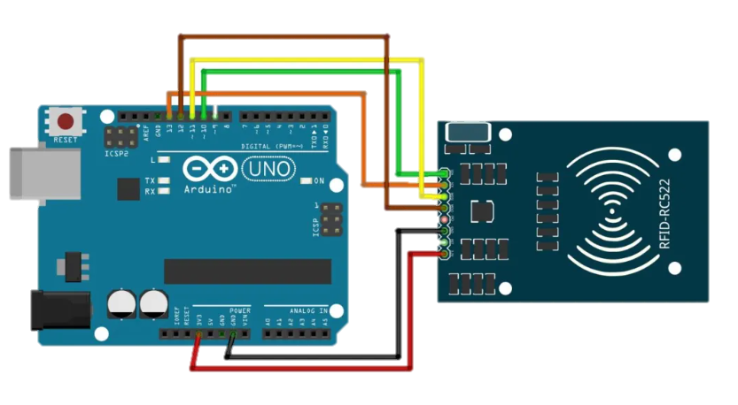

# RFID-Based Cargo Identification and Tracking System

An RFID-based cargo tracking prototype operating at **13.56 MHz**. An **RC522** reader connected to an **Arduino UNO** reads the unique identifier (UID) of a tag attached to a package, retrieves the associated cargo information (cargo ID, country of origin, and type of goods), and displays it on a **16×2 I2C LCD**.

This project was developed as part of the *Embedded Systems Electronics* course (Department of Electronics, Faculty of Electrical Engineering, USTHB).

## Implemented Features

- Detection of a new RFID tag and reading its UID via SPI
- Display of the UID on the LCD
- UID-to-cargo mapping (cargo ID, country of origin, and type of goods)
- Display of the message `"Unknown UID"` for unregistered tags

## Planned Enhancements

These features are described in [the presentation](docs/presentation_rfid_cargo_tracking.pptx) but have not yet been implemented in the current code:

- Cargo door control using a servo motor, including authorization verification
- Temperature and humidity sensors for monitoring storage conditions
- LEDs and a buzzer for alerts
- Movement history (location, date, and time) and anomaly detection

## Hardware

| Component | Details |
|---|---|
| Microcontroller | Arduino UNO |
| RFID Reader | RC522 module (13.56 MHz, SPI) |
| Tags | MIFARE cards/tags |
| Display | 16×2 LCD with I2C module (address `0x27`) |

Complete list: [`hardware/bill_of_materials.md`](hardware/bill_of_materials.md)

## Wiring

### RC522 to Arduino UNO

| RC522 | Arduino UNO |
|---|---|
| SDA (SS) | D10 |
| SCK | D13 |
| MOSI | D11 |
| MISO | D12 |
| RST | D9 |
| 3.3V | 3.3V |
| GND | GND |

### I2C LCD to Arduino UNO

| I2C LCD | Arduino UNO |
|---|---|
| SDA | A4 |
| SCL | A5 |
| VCC | 5V |
| GND | GND |

> **Important:** The RC522 must be powered with **3.3V**. Connecting it to 5V may damage the module.



## Installation

1. Install **Arduino IDE**.
2. Install the following libraries through the Library Manager:
   - **MFRC522** by Miguel Balboa
   - **LiquidCrystal I2C**
3. Open `firmware/rfid_cargo_tracking/rfid_cargo_tracking.ino`.
4. Select the **Arduino UNO** board and upload the sketch.
5. Hold an RFID tag near the reader.

## Adding a New Cargo Item

1. Scan the new RFID tag. Its UID will appear on the LCD.
2. In the `.ino` file, add an `else if (uid == "...")` block containing the cargo ID, country of origin, and type of goods. Each LCD line supports a maximum of 16 characters.

## Registered Cargo Items (Examples)

| UID | Cargo ID | Origin | Type of Goods |
|---|---|---|---|
| `427eee3c` | 1234 | Algeria | Electronics |
| `8bb0ae3` | 5678 | France | Furniture |
| `e3a0d5d` | 9101 | USA | Clothing |
| `73166410` | 1121 | Canada | Food Products |

## Known Limitations

- **UID formatting:** Bytes are converted to hexadecimal without leading zeros (`0x03` becomes `3`). Consequently, two different UIDs may produce the same string. For reliable operation, format each byte using two hexadecimal digits and update the UID table accordingly.
- **Hardcoded UIDs:** Adding a cargo item requires recompiling the program. A possible improvement would be to use a database or an SD card.
- **Insecure UID-based identification:** A MIFARE tag's UID can be cloned. This approach is sufficient for a prototype but not for a real access-control system.
- **Blocking delays:** The program uses `delay()` calls, with a 6-second delay per reading, preventing it from reading another tag during that time.

## Repository Structure

```text
firmware/rfid_cargo_tracking/   Arduino firmware
docs/                           Presentation and wiring diagram
hardware/                       Bill of materials
```

## Author

**Lalili Mohamed Ramzi**

- LinkedIn: https://www.linkedin.com/in/ramzi-lalili-2948a8310/
- Email: ramzilalili@gmail.com

## License

MIT License. See [`LICENSE`](LICENSE) for details.
